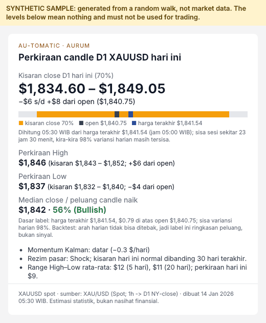
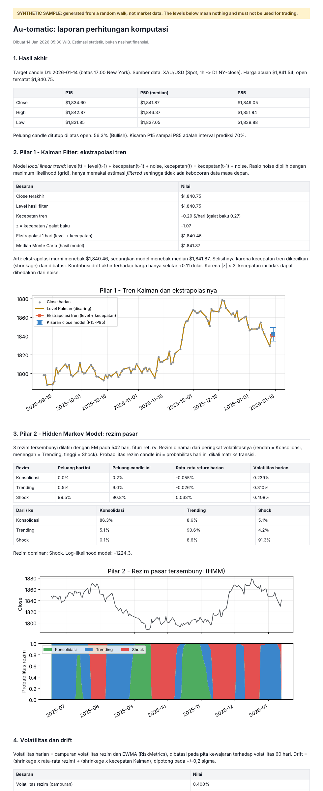
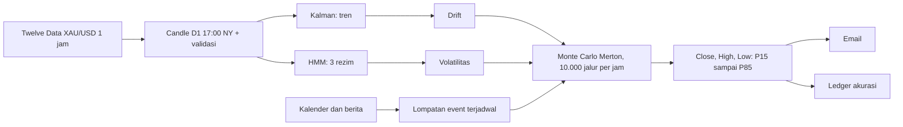

# Au-tomatic

[](https://github.com/Ceryann/Au-tomatic/actions/workflows/ci.yml)

*Au = Aurum (emas). Notifikasi pagi kisaran candle D1 XAUUSD.*

**English abstract.** Au-tomatic is a daily Python bot that emails a probabilistic forecast of today's XAUUSD D1 candle (Close, High, Low as 70% prediction intervals). It builds 17:00-New-York candles from hourly spot data, estimates a trend with a Kalman filter and market regimes with a Hidden Markov Model, and simulates 10,000 intraday Merton jump-diffusion paths with release-hour jumps on high-impact USD event days. It is evaluated by walk-forward backtests and a live public ledger. It makes **no claim of directional skill**: the backtest shows gold's daily direction is not predictable from the trend, and the project reports that negative result openly.

> Estimasi statistik, bukan nasihat finansial. Bukan sinyal entry, SL, atau TP.

## Contoh keluaran (data sintetis)

Gambar di bawah dibuat dari random walk, **bukan harga pasar** (lihat banner pada gambar). Dibuat ulang dengan `python tools/make_samples.py`. Penjelasan lengkap metode ada di [`docs/METHODOLOGY.md`](docs/METHODOLOGY.md).

| Email pagi | Laporan perhitungan (`--explain`) |
|---|---|
|  |  |

## Apa yang dihasilkan

Satu email pagi (Senin sampai Jumat, 05:30 WIB) berisi:

- **Kisaran Close, High, dan Low** candle D1 hari ini (interval prediksi 70%, P15 sampai P85), absolut dan relatif terhadap open.
- Peluang candle naik, rezim pasar, dan momentum tren.
- **Event USD hari ini** (CPI, NFP, FOMC, dan lainnya) dan berita penggerak emas, hanya jika relevan.
- **Akurasi live** 30 hari terakhir dari ledger yang dicatat otomatis.

Batas candle D1 = **17:00 New York**, sama dengan open candle D1 di MT5.

## Cara kerja



1. **Data:** spot XAU/USD per jam dari Twelve Data (± 2,8 tahun). Cadangan: futures `GC=F` dari Yahoo, dengan label jelas. Data divalidasi (tanggal candle terakhir, OHLC, kesegaran feed). Jika gagal, yang dikirim adalah email "prediksi tidak tersedia", tidak pernah angka basi.
2. **Kalman Filter** (local linear trend, hanya estimasi *filtered*): kecepatan tren dalam $/hari.
3. **HMM 3 rezim** (ditulis sendiri dengan numpy, EM berskala): dinamai dari peringkat volatilitas (Konsolidasi, Trending, Shock). Simulasi menunjukkan peringkat volatilitas jauh lebih stabil daripada peringkat rata-rata return.
4. **Monte Carlo Merton jump-diffusion** per jam sampai penutupan candle, dengan profil volatilitas intraday, koreksi Brownian bridge untuk High/Low, dan High/Low yang sudah terjadi.
5. **Event terjadwal:** hari event USD berdampak tinggi menambah varians pada jam rilis, dikalibrasi dengan event study FOMC.
6. **Berita:** kamus heuristik khusus emas (bukan VADER, karena "perang" itu negatif bagi VADER tetapi bullish bagi emas). Hanya ditampilkan, tidak mengubah angka.

## Hasil yang jujur

Uji walk-forward pada 120 sesi emas asli (21 November 2026, `tools/backtest.py`):

| Ukuran | Hasil | Arti |
|---|---|---|
| Close di dalam kisaran 70% | 63,3% (±8,6%) | wajar, sedikit di bawah target |
| High di dalam kisaran | 68,3% (±8,3%) | cocok |
| Low di dalam kisaran | 65,8% (±8,5%) | cocok |
| Pinball loss vs random walk + EWMA | −0,5% | setara, model tidak lebih baik untuk Close |
| Direction Brier | 0,2484 (acak = 0,2500) | **tidak ada kemampuan menebak arah** |
| Ekstrapolasi tren penuh | Brier 0,2488, 2 panggilan arah, 1 benar | tidak memperbaiki apa pun |

Kesimpulan: nilai bot ada pada **kisaran yang terkalibrasi dan perkiraan High/Low**, bukan pada tebakan arah. Label Bullish atau Bearish hampir tidak pernah muncul, dan itu disengaja: ambang tidak diturunkan demi menghasilkan sinyal palsu. Angka di atas dapat berubah saat diuji ulang; akurasi live ada di ledger.

## Mulai cepat

### 1. Siapkan akun dan kunci
- **Twelve Data:** daftar gratis di twelvedata.com, ambil API key. Paket gratis memadai (± 4 sampai 5 credits per hari dari 800).
- **Gmail:** buat OAuth client bertipe Desktop di Google Cloud, lalu jalankan `python tools/gmail_oauth_setup.py` sekali di komputer Anda untuk mendapat refresh token (izin kirim saja). Rinciannya ada di bagian *Pengiriman email dan secret* di bawah. Sandi aplikasi tidak dipakai workflow.

### 2. GitHub Secrets
Repo → *Settings → Secrets and variables → Actions → New repository secret*. Daftar lengkap lima secret yang dibutuhkan ada di tabel pada bagian *Pengiriman email dan secret* di bawah. `EMAIL_TO` boleh berisi beberapa alamat dipisah koma (saling tersembunyi).

### 3. Jalankan
*Actions → Au-tomatic Daily → Run workflow*. Pertama dengan **dry_run dicentang** (memeriksa seluruh jalur tanpa mengirim email dan tanpa mencetak level harga), lalu tanpa centang untuk mengirim email sungguhan. Jadwal otomatis: **Minggu sampai Kamis 22:30 UTC** (Senin sampai Jumat 05:30 WIB).

### Di komputer sendiri (Windows PowerShell)

```powershell
python -m venv .venv
.venv\Scripts\Activate.ps1
python -m pip install -r requirements.txt        # pakai "python -m pip", bukan "pip"
python -m pytest -q                              # tes offline, tanpa internet

$env:TWELVEDATA_API_KEY = "key-anda"             # hanya berlaku di jendela ini
python main.py --dry-run --explain               # out\preview.html dan out\report.html
```

| Opsi `main.py` | Fungsi |
|---|---|
| `--dry-run` | tidak mengirim email, hanya menulis `out/preview.*` |
| `--explain` | juga menulis `out/report.html`: setiap langkah hitung dengan angka dan grafik |
| `--now 2026-11-13T22:30:00Z` | memutar ulang momen tertentu |
| `--no-news`, `--no-macro`, `--no-ledger` | matikan radar berita, fitur DXY/US10Y, atau ledger |
| `--event` | anggap hari ini hari event (kisaran dilebarkan) |
| `--data-check` | hanya email tes data |

## Alat evaluasi

| Perintah | Fungsi |
|---|---|
| `python tools/backtest.py --sessions 120` | uji walk-forward di data asli (3 sampai 4 credits) |
| `... --set model.drift.k_kalman=1 --set model.drift.cap_sigma_mult=10` | uji ekstrapolasi tren penuh |
| `python tools/event_study.py` | ukur apakah hari FOMC lebih bergejolak, dan sarankan `event_extra_var` |
| `python tools/compare_mt5.py XAUUSD_D1.csv` | bandingkan dengan ekspor D1 dari MT5 Anda |
| `python tools/probe_news.py` | cek feed kalender dan berita mana yang hidup di komputer Anda |
| `python tools/probe_twelvedata.py`, `probe_symbols.py` | uji sumber data |
| `python tools/probe_holidays.py` | hitung jumlah bar per jam pada sesi hari libur AS di riwayat Twelve Data (hanya angka bar, tanpa harga) |
| `python tools/gmail_oauth_setup.py` | sekali pakai di komputer Anda: membuat refresh token Gmail API (izin kirim saja) untuk secret `GMAIL_OAUTH_REFRESH_TOKEN` |
| `python tools/probe_smtp.py` | diagnosis login SMTP Gmail (hanya mencetak tahap dan jenis error) |

Ekspor MT5: *View → Symbols → tab Bars* → simbol emas, D1, 60+ hari → *Export Bars*.

## Ledger akurasi live

Setiap run sungguhan menambah satu baris ke `data/predictions_log.csv`, dan workflow meng-commit-nya. Esok harinya baris itu "diselesaikan": apakah close, high, dan low jatuh di dalam kisaran. Isi ledger aman untuk repo Public: hanya selisih relatif (pecahan), probabilitas, rezim, dan penanda 0/1. **Tidak ada harga mentah.** Commit harian juga menjaga jadwal tetap aktif (GitHub mematikan jadwal di repo Public setelah 60 hari tanpa aktivitas).

## Pengiriman email dan secret

Gmail menutup login SMTP dari server GitHub (dibuktikan dengan `tools/probe_smtp.py`: akun uji palsu pun diputus), jadi jalur utama adalah **Gmail API lewat HTTPS** dengan izin `gmail.send` saja. Layar persetujuan OAuth harus berstatus **In production**; pada status Testing refresh token mati tiap 7 hari. Token dibuat sekali dengan `tools/gmail_oauth_setup.py`.

| Secret (Settings > Secrets and variables > Actions) | Isi |
|---|---|
| `TWELVEDATA_API_KEY` | kunci API Twelve Data |
| `GMAIL_OAUTH_CLIENT_ID`, `GMAIL_OAUTH_CLIENT_SECRET` | OAuth client bertipe Desktop |
| `GMAIL_OAUTH_REFRESH_TOKEN` | keluaran `tools/gmail_oauth_setup.py` |
| `EMAIL_TO` | satu atau lebih alamat tujuan, dipisah koma |

Setiap run mencatat `EMAIL_TO: N usable recipient(s).` di log (hanya jumlah, tidak pernah alamatnya), ditambah peringatan bila ada entri yang rusak atau ganda. Pada *dry run* baris ini muncul tanpa mengirim email, sehingga secret `EMAIL_TO` yang kosong atau salah ketahuan sebelum pengiriman sungguhan. Pastikan N sama dengan jumlah penerima yang Anda maksud.

SMTP (`GMAIL_USER` + `GMAIL_APP_PASSWORD`) tetap didukung kode untuk uji dari komputer sendiri, tetapi tidak dipakai workflow.

## Struktur

```text
main.py                     # orkestrator
config.yaml                 # semua parameter
src/data_fetcher.py         # Twelve Data + Yahoo, candle NY-close, validasi, fallback
src/hmm.py                  # Gaussian HMM (numpy)
src/signal_and_regime.py    # Kalman, fitur, pemetaan rezim
src/quant_engine.py         # volatilitas, lompatan, event terjadwal, Monte Carlo
src/news_sentinel.py        # kalender, RSS, kamus sentimen emas
src/ledger.py               # ledger prediksi + akurasi live
src/evaluation.py           # walk-forward dan event study
src/report.py               # laporan komputasi (angka + grafik)
src/email_dispatcher.py     # email HTML + teks, Gmail API (HTTPS), SMTP cadangan
tests/                      # 102 tes offline (tanpa jaringan)
tools/                      # backtest, event_study, probe, compare_mt5, make_samples
docs/                       # METHODOLOGY.md, contoh sintetis (samples/, img/)
.github/workflows/          # daily_xauusd.yml (jadwal), ci.yml (tes)
```

## Penggunaan data dan privasi

- Paket gratis Twelve Data hanya untuk **penggunaan pribadi dan non-komersial**, dan tidak mengizinkan menampilkan atau mendistribusikan datanya ke pihak ketiga. Karena itu email hanya dikirim ke akun milik sendiri dan **repo ini tidak menyimpan data harga mentah**.
- Log GitHub Actions di repo Public bersifat publik, jadi log hanya memuat angka relatif. Workflow tidak mengunggah file hasil.
- Jangan menaruh kunci, sandi, atau alamat email di kode, log, atau commit. Periksa syarat terbaru di twelvedata.com sebelum membagikan hasil kepada orang lain.

## Keterbatasan

- Data gratis tidak resmi dan bisa terlambat, kosong, atau diblokir. Karena itu ada retry, fallback bertingkat, dan email error.
- Model terkalibrasi pada data sintetis dan cukup baik pada 120 sesi emas asli, tetapi sampelnya kecil. Pantau akurasi live di ledger.
- Pengaruh event dikalibrasi dari hari FOMC yang hanya sekitar 20 sampai 23 hari, jadi selang kepercayaannya lebar. `event_extra_var` bawaan (0,5) adalah prior yang wajar, bukan hasil pasti.
- Feed berita dan kalender gratis bisa berubah atau mati. Feed yang gagal dilewati dan email menyebutkannya.
- Hari libur AS: sesi yang terdaftar di `data.holidays` (config.yaml) diperiksa dengan ambang bar lebih rendah (`holiday_min_bars`) dan, bila `absent_ok`, boleh kosong; email diberi catatan likuiditas tipis. Daftar dan ambang ini **sementara** sampai `probe_holidays.py` dijalankan di data asli; hari tipis yang tidak terdaftar tetap ditolak. Jika sesi target adalah hari libur `absent_ok` (mis. 25 Des, 1 Jan, Jumat Agung) **dan** semua sumber data gagal, bot mengirim email singkat "Pasar libur hari ini" (tanpa angka, run hijau) dan alasan teknisnya hanya dicatat di log; di hari lain kegagalan data tetap menjadi email error.
- Sentimen berita memakai kamus heuristik yang tidak bisa divalidasi (tidak ada arsip berita historis), sehingga hanya ditampilkan.

## Roadmap

1. Selesai: data, validasi, email (Gmail API), model, ledger, radar berita dan kalender, validasi sadar hari libur AS (sementara).
2. Berikutnya: verifikasi fitur makro di data asli, ringkasan akurasi live per rezim dan hari event.
3. Opsional: Ridge atau LightGBM dengan fitur makro (DXY, US10Y, suku bunga riil), hanya jika lolos aturan penerimaan yang ditetapkan sebelum melihat hasil (pinball Close membaik minimal 1% dengan selang bootstrap 95% tidak memuat 0, cakupan tetap 60 sampai 80%, lolos uji kebocoran).

## Lisensi

MIT. Lihat `LICENSE`.
